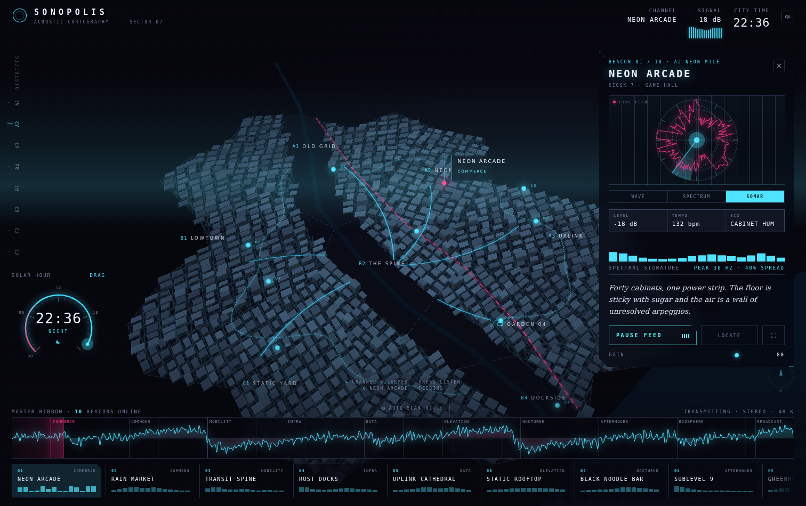
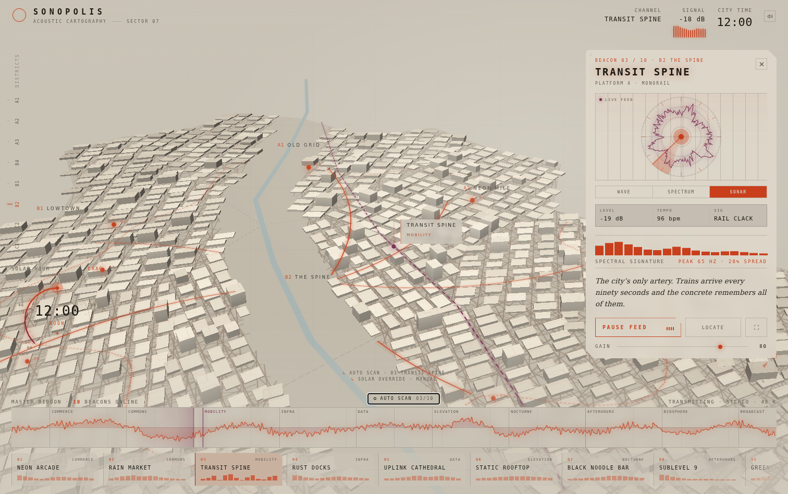
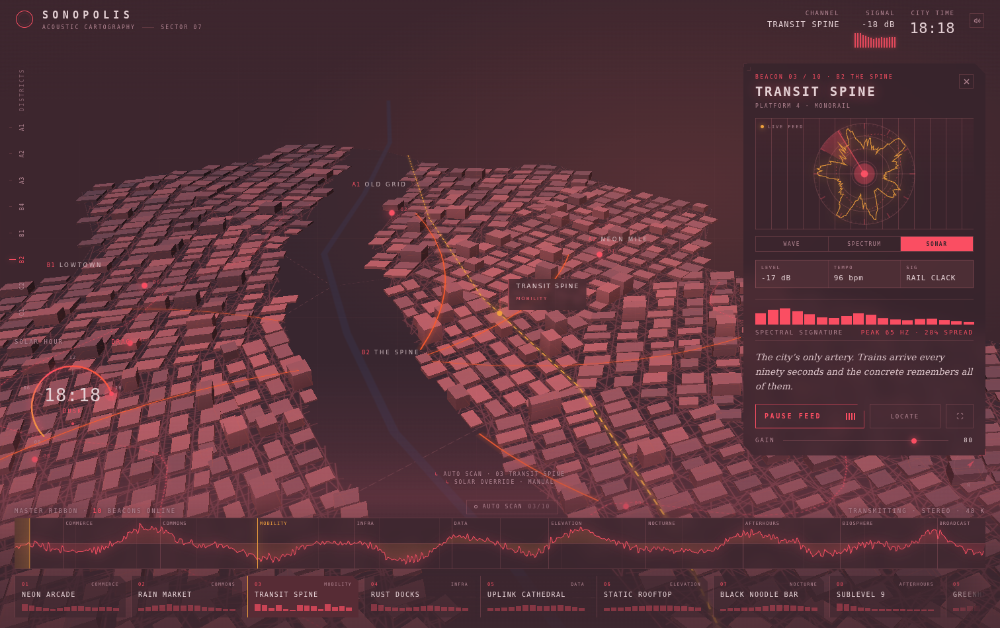
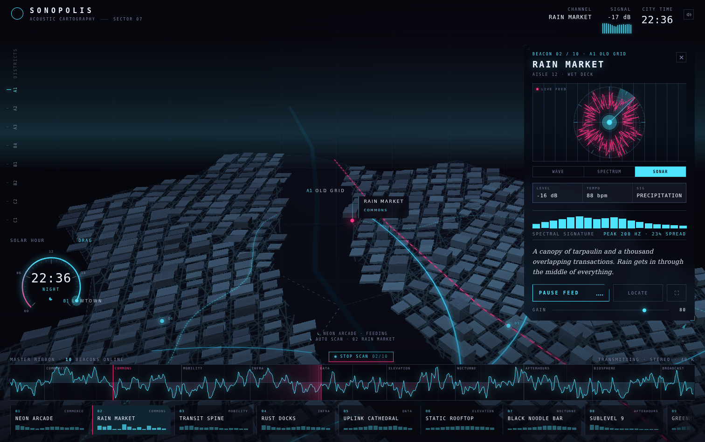
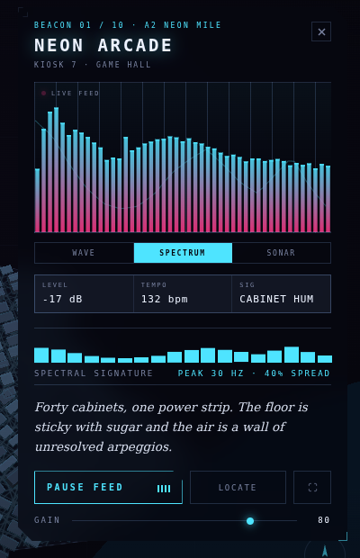
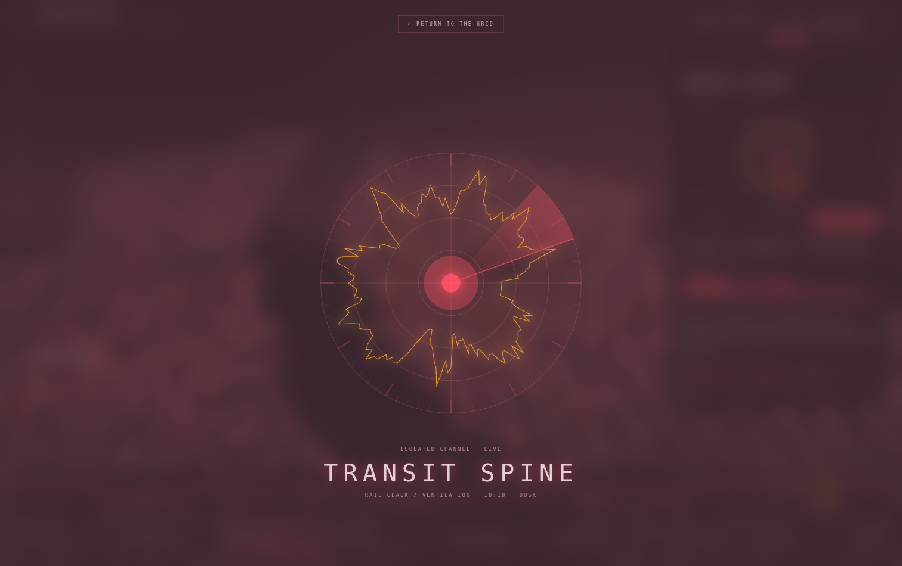
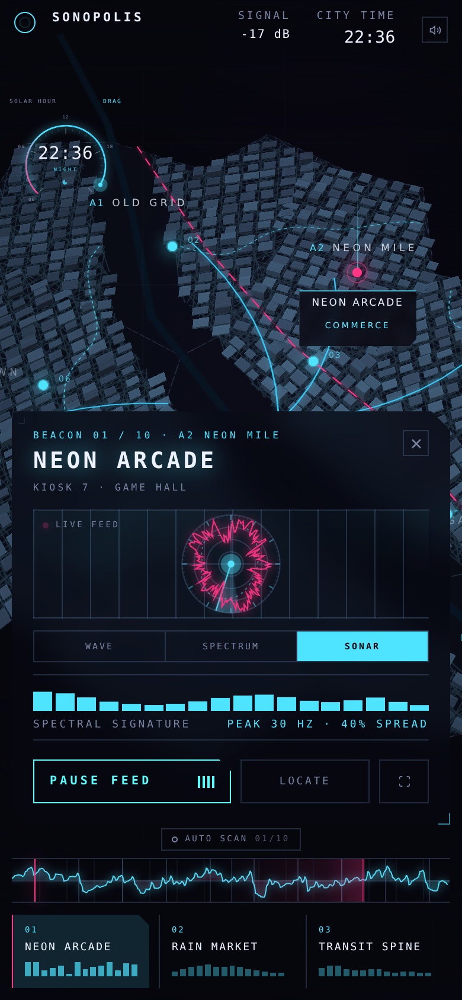
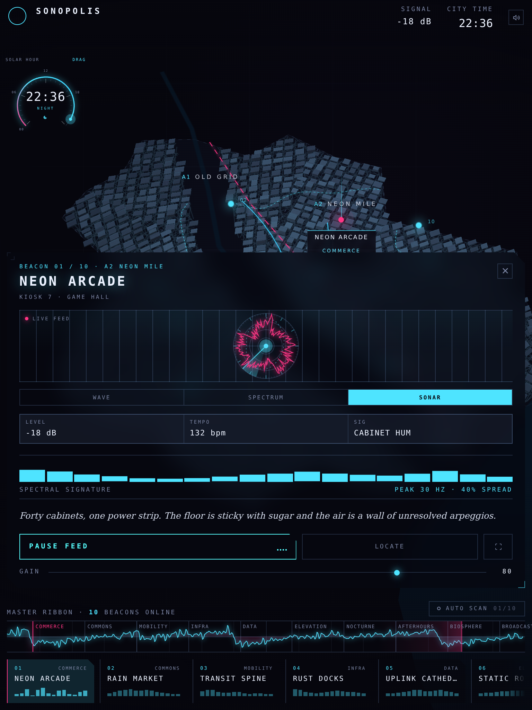
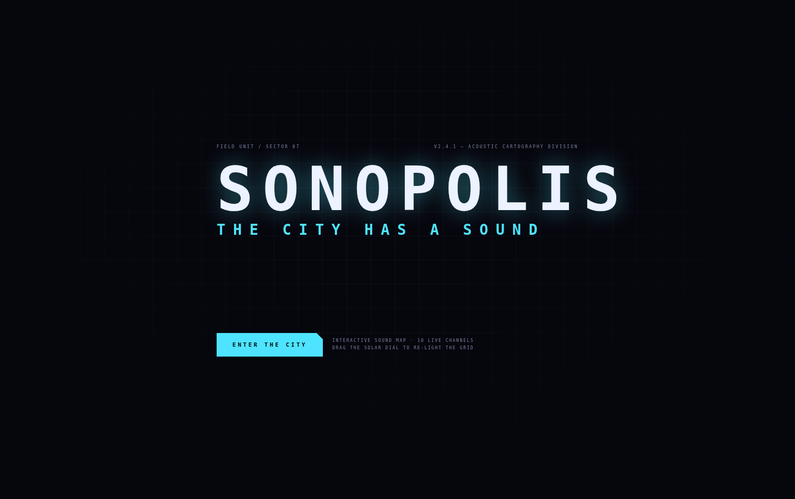

# SONOPOLIS — *the city has a sound*

**An acoustic map of a city that does not exist.** Ten districts, ten synthesised channels,
one solar dial that repaints everything from the map paint to the smallest caption.
Every building, street, texture and sound is generated in the browser at runtime —
no image assets, no audio samples, no network requests.

<p align="center">
  
</p>

<p align="center">
  <a href="https://sonopolis-two.vercel.app"></a>
  <a href="#quick-start"></a>
  <a href="#quick-start"></a>
  <a href="#the-map"></a>
  <a href="#the-sound"></a>
  
</p>

---

## Table of contents

- [The idea](#the-idea)
- [Screenshots](#screenshots)
- [Features](#features)
- [Quick start](#quick-start)
- [Controls](#controls)
- [The colour clock](#the-colour-clock)
- [The sound](#the-sound)
- [Spectral signatures](#spectral-signatures)
- [The map](#the-map)
- [Architecture](#architecture)
- [Responsive behaviour](#responsive-behaviour)
- [Dev tools](#dev-tools)
- [Notes & gotchas](#notes--gotchas)
- [License](#license)

---

## The idea

> A cartographer's field unit for a city you can only hear.

SONOPOLIS treats sound as a *place*. Each district is a beacon on a 3D block map and a
patch of synthesised sound: the arcade hums with cabinet transformers, the market is a wall
of overlapping voices and rain on tarpaulin, the transit spine keeps the 96 bpm of a
monorail that arrives every ninety seconds. Selecting a beacon opens a channel; pressing
**listen** feeds it into the mix. The solar dial moves the city through a day and repaints
the entire interface, because a city at 03:00 and the same city at noon should not look
like the same instrument.

Everything is procedural: the island is grown from a seeded PRNG, the style is built inline
from GeoJSON, and all ten channels are Web Audio graphs scheduled in the browser.

---

## Screenshots

### Night — the default state


### Noon — the same city, different machine



### Dusk, after dragging the solar dial



### Auto scan — walking all ten beacons



### The channel card

<p align="center">
  
</p>

### Isolated channel



### Phone and tablet

<p align="center">
  
  &nbsp;&nbsp;
  
</p>

### Boot screen



---

## Features

| | |
| --- | --- |
| **10 synthesised channels** | Oscillators, noise, filters, LFOs and a step scheduler — no samples. Each patch has its own tempo, filter envelope and register. |
| **Procedural city** | Seeded PRNG → coastline, 8 districts, ~1 200 extruded blocks, ~870 street segments, a river with bridges. Rendered by MapLibre from inline GeoJSON. |
| **Colour clock** | Seven keyframes drive every colour token: map background, water, extrusion gradient, street glow, HUD ink, panel, haze. A legibility guard keeps text readable through the crossfades. |
| **Auto scan** | Walks all ten beacons on a 9 s timer, flying the camera and logging each stop. `T` toggles it; any manual pick cancels it. |
| **Spectral signatures** | Every channel carries a fixed 18-band fingerprint, printed on the dock plates and drawn as a ghost reference inside the analyser. |
| **Three analysers** | Sonar (radial), spectrum (bars) and wave (mirrored envelope), all driven by the live analyser node with a fixed makeup gain. |
| **Isolate mode** | A full-screen instrument with the city blurred behind it. |
| **Loudness matched** | Per-channel trim table keeps every district inside a 3 dB window (see [the sound](#the-sound)). |
| **Responsive** | Desktop HUD → tablet/phone bottom sheet → landscape fallback, plus a phone-specific map framing. |
| **No network** | Fonts are system stacks, the MapLibre worker is bundled, the style is inline. Works offline after the first load. |

---

## Quick start

**Live:** <https://sonopolis-two.vercel.app> — best with headphones, desktop first.

```bash
npm install
npm run dev        # http://localhost:5173
npm run build      # dist/  → ~1.49 MB js (426 kB gzip) + 519 kB maplibre worker
npm run preview    # serve the production build
```

Audio needs a user gesture, so the app opens on a boot screen: **Enter the city** unlocks
the `AudioContext` and arms the first channel.

---

## Controls

| Input | Action |
| --- | --- |
| **Enter the city** | unlock audio, mount the map |
| Click a beacon, dock plate or rail code | select a channel (`1`–`9`, `0`) |
| **Listen / Pause feed** or `Space` | start / stop the channel |
| Drag the **solar dial**, or `←` `→` | move time of day (±15 min) |
| `N` | jump between day and night |
| **Wave / Spectrum / Sonar** | switch the analyser rendering |
| **Gain** slider | master volume |
| **Auto scan** or `T` | walk every beacon in order |
| `⤢` in the channel card | isolate the channel (full screen) |
| `Esc` | leave isolate, stop auto scan |
| **Locate** | fly the camera to the selected beacon |

---

## The colour clock

`src/lib/palette.js` holds seven keyframes; the hour is interpolated between them and the
result is written to CSS custom properties *and* to the live MapLibre style.

| Hour | Phase | Background | Accent |
| --- | --- | --- | --- |
| 00:00 | NIGHT | `#04060c` | `#2ff0ff` |
| 04:36 | PRE-DAWN | `#05070f` | `#5b8dff` |
| 07:12 | DAWN | `#2b2434` | `#ffb08a` |
| 12:00 | NOON | `#c9c3b6` | `#c93f1c` |
| 16:12 | AFTERNOON | `#c2ae92` | `#d94a17` |
| 18:36 | DUSK | `#2a1220` | `#ff4f6d` |
| 20:24 | NIGHTFALL | `#08060f` | `#7fd0ff` |

Two guards keep the interface usable at every minute of the day:

- **Legibility guard** — if the interpolated background and ink fall below 5.5:1, the
  palette re-picks a light or dark ink based on the background luminance.
- **Ink halo** — the top bar, rail and captions carry a text-shadow in the palette
  background colour, so small caps stay readable over a bright map.

---

## The sound

```
patch voices ──▶ scene bus (per-channel trim) ──▶ compressor ──▶ master ──▶ destination
                                                                  └─▶ analyser ──▶ UI
```

The analyser sits behind a compressor, so the visuals apply a fixed makeup gain
(×2.4–3.8, clamped) instead of pretending the numbers are linear.

| # | Channel | Signal | Patch | Loudness |
| --- | --- | --- | --- | --- |
| 01 | Neon Arcade | cabinet hum, coin logic | `arcade` | −17 dBFS |
| 02 | Rain Market | voices, tarpaulin, wet deck | `market` | −16 dBFS |
| 03 | Transit Spine | rail rhythm, steel on steel | `transit` | −18 dBFS |
| 04 | Rust Docks | hull resonance, chains | `docks` | −18 dBFS |
| 05 | Uplink Cathedral | detuned choir, antenna air | `uplink` | −19 dBFS |
| 06 | Static Rooftop | wind over the roof deck | `rooftop` | −18 dBFS |
| 07 | Black Noodle Bar | rain on a tin roof | `noodle` | −16 dBFS |
| 08 | Sublevel 9 | almost everything below 120 Hz | `sublevel` | −19 dBFS |
| 09 | Greenhouse | glass, water, leaves | `greenhouse` | −16 dBFS |
| 10 | Signals | carriers, bursts, dead air | `signals` | −17 dBFS |

The `TRIM` table in `src/audio/engine.js` was measured channel by channel with
`tools/audiotest.mjs` (RMS at gain 80 / master 1.4). Spread: **3 dB across ten very
different textures** — enough headroom that the master never clips on peaks.

Time of day also bends the sound: `setTimeOfDay()` sweeps the air band from 2.6 kHz to
17.6 kHz, tilts a high shelf, opens the reverb and calls a per-patch `macro()`.

---

## Spectral signatures

Each channel owns a fixed 18-band fingerprint (30 Hz → 14 kHz) in `src/lib/signature.js`.
It is a design document as much as a graphic: it is the shape the district is *supposed*
to have.

- printed as bars on every dock plate, so ten plates read as ten different shapes;
- drawn as a dashed polygon inside the sonar, a ghost outline behind the spectrum bars and
  a soft envelope across the wave;
- summarised in the channel card as `peak 200 Hz · 23% spread`.

Because the fingerprint is independent of playback, a paused channel still looks like
itself — the ghost is the reference, the live trace is the performance.

---

## The map

- **Style** is built inline (`buildStyle()` in `CityMap.jsx`) from six GeoJSON sources, with
  no tile server. Layers: `bg`, `districts`, `district-lines`, `water`, `river`, `coast`,
  `streets-glow`, `streets`, `blocks` (fill-extrusion with a vertical gradient),
  `block-edges`, `arterial-*`, `ring-*`, `monorail-*`.
- **Beacons** are MapLibre DOM markers: a beam, a pulse, a dot, an index chip and a plate
  that appears on hover and stays for the active channel.
- **Sound lens** is a cursor instrument that follows the pointer over the map and reads the
  current level in dB; it hides automatically over the HUD.
- **Camera** starts at zoom 12.26 / pitch 44 / bearing −27, framed left of the channel
  card, and reframes itself on phones and short viewports.
- The MapLibre worker is bundled with `?worker&url` + `setWorkerUrl()`, so the app works
  with no CDN and no `blob:` worker.

---

## Architecture

```
src/
  App.jsx                 state: phase, hour, selection, playback, mode, solo, tour
  audio/
    engine.js             Web Audio graph, trim table, macros, analyser accessors
    patches.js            ten channel recipes (voices, filters, rng sequencing)
  data/city.js            procedural island / districts / blocks / streets / beacons
  lib/
    prng.js               mulberry32 + helpers (deterministic city)
    geo.js                polygon, extrusion and street helpers
    palette.js            hour → palette, contrast guard, clock formatters
    signature.js          18-band fingerprints per channel
  components/
    CityMap.jsx           MapLibre setup, layers, beacons, lens, palette sync
    Visualizer.jsx        sonar / spectrum / wave renderers + useCanvasLoop
    TimeDial.jsx          270° solar dial (SVG, pointer drag)
    Hud.jsx               top bar, signal meter, district rail, log lines
    SoundPanel.jsx        channel card: analyser, signature, meta, gain
    Dock.jsx              master ribbon, auto scan control, channel plates
    Isolate.jsx           full-screen channel view
    Boot.jsx              entry screen
  styles/global.css       the whole visual system + responsive rules
```

**Interaction model.** `App` owns everything; the map, HUD and audio engine are
subscribers. A channel change is a single state write — `selectedId` — and the map marker,
the card, the analyser, the audio graph and the log all follow from it.

---

## Responsive behaviour

| Viewport | Layout |
| --- | --- |
| ≥ 1081 px | full HUD: district rail, dial bottom-left, card on the right |
| ≤ 1080 px | rail hidden, dial scaled, narrower card |
| ≤ 900 px tall | rail tightened, ribbon and plates compressed |
| ≤ 820 px tall | card is bounded above the master ribbon and the copy is dropped below 748 px — the action buttons can never end up under the dock (the 1366×768 laptop case) |
| ≤ 820 px wide | card becomes a bottom sheet that grows upward, dial moves under the brand, beacons label themselves below the dot |
| ≤ 520 px wide | meta grid and description hidden, ribbon reduced to 38 px, dock captions hidden |
| ≤ 640 px tall | landscape fallback: scrollable card anchored above the dock, dial hidden |

The map reframes itself for compact viewports (lower zoom, less pitch, centre lifted) so
the island stays above the bottom sheet.

---

## Dev tools

Scripts in `tools/` need Playwright and a running dev server on port 5173:

```bash
node tools/shot.mjs http://localhost:5173/ out.png [selector]   # screenshot
node tools/shots.mjs                                           # regenerate docs/ gallery
node tools/livecheck.mjs https://sonopolis-two.vercel.app      # smoke-test a deployment (3 viewports)
node tools/audiotest.mjs                                       # per-channel RMS / dB report
npx playwright install chromium                                # one-time browser install
```

Headless Chromium needs `--use-gl=angle --use-angle=swiftshader --enable-unsafe-swiftshader`
for WebGL and `--autoplay-policy=no-user-gesture-required` for audio; every script already
passes them.

---

## Notes & gotchas

- `maplibre-gl` must be imported as a **named** export (`{ Map }`) — the default export does
  not exist in this build.
- The worker has to be bundled explicitly: `import workerUrl from '…?worker&url'` +
  `setWorkerUrl(workerUrl)`.
- MapLibre's own stylesheet sets `position: relative` on `.maplibregl-map`, so the canvas
  needs the more specific `.map-shell > .map-canvas { position: absolute; inset: 0 }`.
- `setPaintProperty` can silently fail while the style is still loading; the palette effect
  applies immediately and again on `load` / `idle`, otherwise the map keeps a stale palette
  after a fast dial drag.
- Never feed a `rgba()` string into a MapLibre colour interpolation — the palette therefore
  interpolates `panel`, `line` and `haze` channel-wise (`RAW_KEYS`).
- An LFO depth must be a gain, not a frequency. Using Hz as an amplitude silenced every
  channel while the analyser still reported a flat 127.

---

## License

MIT — see [LICENSE](LICENSE).

The city, the names and the copy are fiction. Any resemblance to a real district is a
coincidence of the PRNG.
